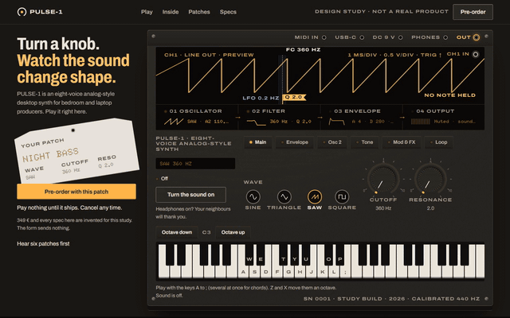
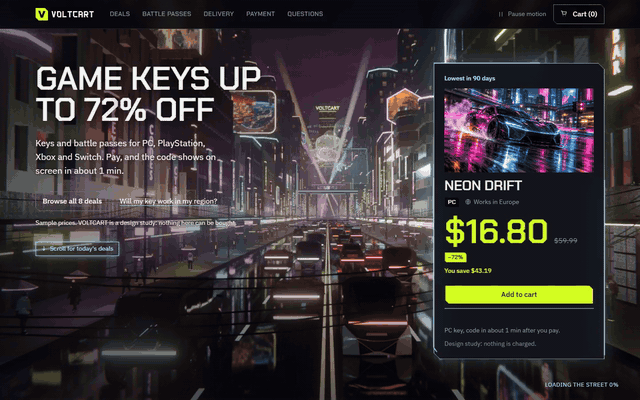
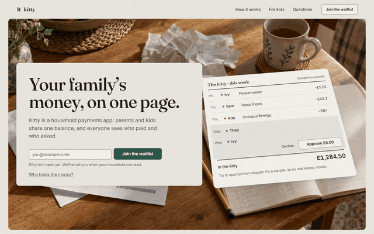
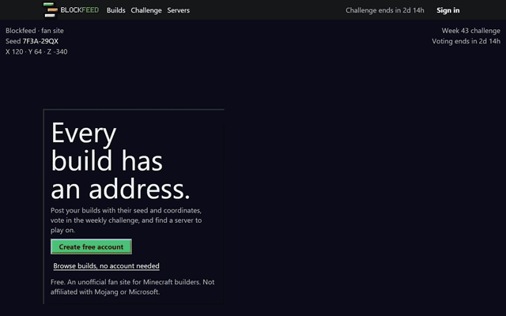
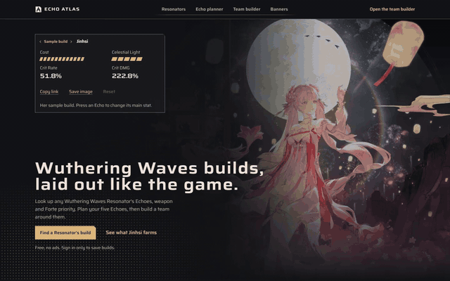

# Landing pages

A growing collection of landing pages, each with its own look, motion and component set. Every one is a
standalone React 19 + TypeScript + Vite + Tailwind 4 app with GSAP and Lenis for scroll-driven motion.

Made with a tool I'm building. More on that soon.

---

## PULSE-1 — a desktop synth you can play on the page



A pre-order page for an eight-voice desktop synth. The hero is the instrument: play it with your computer keys or the
on-screen keyboard, switch waves and turn knobs, and the oscilloscope draws the sound live. Then a full-screen
rendered film assembles the synth part by part, six patches to try, specs and a pre-order form.

`pulse-system/`

## VOLTCART — game-key deals in a neon city



A cyberpunk storefront for game keys and battle passes. A rendered street film plays behind the page as you scroll:
today's deals with 90-day price history, battle passes, a delivery walkthrough with a sample code, payment
reassurance and a FAQ.

`neon-store-system/`

## Maison Sucre — wedding cakes made to order


A wedding-cake maker. A rendered camera climbs a four-tier cake tier by tier, then a filterable cake gallery, a
live-price "design yours" builder with a 3D cake, flavours, delivery check and tasting booking.

`maison-sucre-system/`

## Kitty — the household payments app



A waitlist page for a family money app: one shared balance, split bills, pocket money and kids' requests, told as a
week of a sample household's ledger on the kitchen table.

`fintech-system/`

## Blockfeed — a community for block builders



A pixel-art community site: a voxel world you can place blocks in, the week's builds with seeds and coordinates,
the weekly challenge vote, a server finder and safety tools.

`blockfeed-system/`

## Echo Atlas — Wuthering Waves build hub



A fan hub laid out like the game's own UI: a Resonator's Echo build slot by slot, an Echo planner, a team builder
and live banner countdowns.

`wuwa-hub-system/`

---

## Run one locally

Each folder is its own app. Node 20.19 or newer.

```bash
cd neon-store-system
npm install
npm run dev
```

The page opens at `http://localhost:5190/p/<slug>`: `pulse-landing`, `voltcart-landing`, `maison-sucre-landing`, `fintech-landing`,
`blockfeed-landing` or `tidelog-landing`. For the production build, run `npm run build && npm run preview`
(port 5191).

## Credits and notes

- All brands, products, prices, people and reviews on these pages are invented samples. Nothing is for sale.
- Blockfeed is not an official Minecraft product and is not approved by or associated with Mojang or Microsoft.
- Echo Atlas is an unofficial, non-commercial fan project, not affiliated with or endorsed by Kuro Games. Character
  art and in-game icons belong to Kuro Games; see
  [`wuwa-hub-system/public/resonators/full/CREDITS.md`](wuwa-hub-system/public/resonators/full/CREDITS.md).
- The VOLTCART and Maison Sucre films were rendered in Blender with CC0 assets from [Poly Haven](https://polyhaven.com)
  and free models from [BlenderKit](https://www.blenderkit.com). The PULSE-1 film was modelled and rendered in
  Blender from scratch. Only the rendered frames ship here.
- PULSE-1 is a fictional product. Its line-in track is not included; the page works without it.
